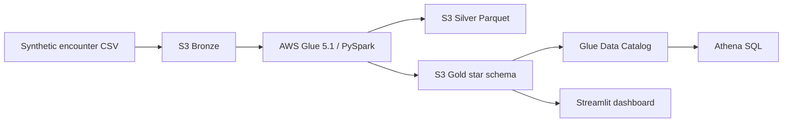

# CareSignal Hospital Readmission Data Pipeline

An end-to-end **simulated portfolio project** that combines an AWS-style Data Engineering
pipeline with a Streamlit hospital-readmission dashboard. It demonstrates batch ingestion,
PySpark transformation, Bronze/Silver/Gold storage, data-quality controls, star-schema
modeling, AWS Glue, Amazon S3, the Glue Data Catalog and Athena SQL.

> All records are synthetic. This is not a production hospital system, a validated clinical
> model or a source of medical advice.

## What changed from the original dashboard

The original application generated synthetic data inside Streamlit. The upgraded project keeps
that dashboard and adds a separate engineering workflow:

1. Generate a deterministic synthetic encounter extract.
2. Store the source as a Bronze CSV.
3. Validate and transform it with PySpark.
4. Write clean and rejected records to Silver Parquet.
5. Build Gold dimensions, an encounter fact table and reporting marts.
6. Write a row-count reconciliation manifest.
7. Load the Gold dashboard extract when it exists; otherwise use the original safe fallback.

## Architecture



See [docs/architecture.md](docs/architecture.md) for the data model, controls and design choices.

## Technology stack

- Python, pandas and NumPy
- PySpark 3.5.6 and Java 17
- Parquet and CSV
- AWS S3, Glue 5.1, Glue Data Catalog and Athena
- Streamlit and SQLite authentication
- CloudFormation infrastructure as code
- Python `unittest` and GitHub Actions CI

AWS Glue 5.1 uses Spark 3.5.6 and Python 3.11, so the local Spark dependency is pinned to the
same Spark release. See the official [AWS Glue version documentation](https://docs.aws.amazon.com/glue/latest/dg/release-notes.html).

## Repository structure

```text
.
|-- app.py                         # Streamlit dashboard
|-- data_loader.py                 # Gold-output loader with fallback
|-- database.py                    # Local authentication database
|-- pipeline/
|   |-- generate_data.py           # Deterministic synthetic source
|   |-- quality.py                 # Source contract checks
|   `-- spark_job.py               # Local and AWS Glue PySpark ETL
|-- infra/cloudformation.yml       # AWS resources
|-- scripts/
|   |-- run_local.ps1              # Windows local workflow
|   |-- run_local.sh               # Linux/macOS local workflow
|   `-- upload_and_run_aws.py      # S3 upload and Glue launcher
|-- sql/athena_analysis.sql        # Analytics and quality queries
|-- tests/                         # Unit and Spark integration tests
`-- docs/architecture.md
```

## Run locally on Windows

### Prerequisites

- Python 3.11
- Java 17 with `JAVA_HOME` configured
- Git

Open PowerShell in the repository folder and run:

```powershell
Set-ExecutionPolicy -Scope Process Bypass
.\scripts\run_local.ps1
```

Then start the dashboard:

```powershell
.\.venv\Scripts\streamlit.exe run app.py
```

Demo login:

- Username: `admin`
- Password: `CareSignal2026!`

## Run individual local steps

```powershell
py -3.11 -m venv .venv
.\.venv\Scripts\Activate.ps1
python -m pip install -r requirements.txt
python -m pipeline.generate_data --rows 5000
spark-submit pipeline\spark_job.py --input_path data\bronze\encounters --output_path data
python -m unittest discover -s tests -v
streamlit run app.py
```

The generated `data/` layers are intentionally excluded from Git.

## Optional AWS deployment

AWS deployment requires an AWS account and can consume credits or create charges. Review the
template and set an AWS budget before deployment.

### 1. Deploy infrastructure

```powershell
aws cloudformation deploy `
  --template-file infra/cloudformation.yml `
  --stack-name caresignal-readmission `
  --capabilities CAPABILITY_NAMED_IAM
```

Read the stack outputs for `DataBucketName` and `GlueJobName`.

### 2. Upload assets and run Glue

```powershell
python scripts/upload_and_run_aws.py `
  --bucket YOUR_BUCKET_NAME `
  --job-name caresignal-readmission-etl `
  --run --wait
```

### 3. Catalog and query Gold data

Run the deployed Glue crawler, then execute the queries in
[`sql/athena_analysis.sql`](sql/athena_analysis.sql) using the deployed Athena workgroup.

## Gold model

- `dim_patient`
- `dim_facility`
- `dim_diagnosis`
- `dim_date`
- `fact_encounter`
- `mart_facility_readmission`
- `mart_diagnosis_readmission`
- `mart_monthly_readmission`
- `dashboard` CSV extract

## Data-quality controls

- Explicit input schema
- Required identifier and date checks
- Duplicate encounter rejection
- Valid age, length-of-stay and risk-score ranges
- Accepted risk-band values
- Raw-to-Silver-plus-rejected row reconciliation
- Separate rejected-record output with reasons
- Successful-run manifest
- Athena duplicate and referential-integrity queries

## Test the project

```powershell
python -m unittest discover -s tests -v
```

GitHub Actions runs compilation, unit tests and the local Spark integration test on every pull
request and push to `main`.

## Honest portfolio description

Use this wording only after you have personally run and explained the project:

> Built a simulated hospital-readmission batch pipeline using Python, PySpark and an AWS
> S3/Glue/Athena architecture. Implemented Bronze/Silver/Gold layers, Parquet transformations,
> star-schema marts, rejected-record handling, reconciliation checks, infrastructure as code and
> automated tests. Connected the Gold output to a Streamlit analytics dashboard.

Do not claim that this project processed real patients, ran in a company production environment,
produced clinical recommendations or delivered verified financial savings.
