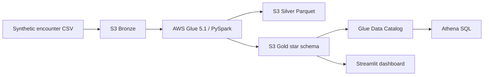
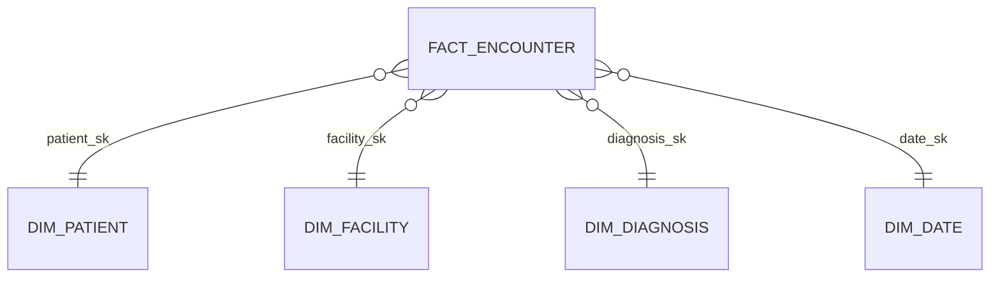

# CareSignal Data Engineering Architecture

## Data flow

The same PySpark script runs locally with `spark-submit` and in AWS Glue. Local output is written
under `data/`; AWS output is written to the project S3 bucket.

## Layer responsibilities

| Layer | Purpose | Format |
| --- | --- | --- |
| Bronze | Immutable source extract | CSV |
| Silver | Validated, standardized encounters plus rejected rows | Parquet |
| Gold | Dimensions, encounter fact, summary marts, dashboard extract | Parquet + CSV extract |

## Gold star schema

`encounter_id` is the fact table business key. Surrogate dimension keys are deterministic hashes,
which keeps reruns idempotent for this portfolio dataset.

## Quality controls

- Explicit source schema instead of inference.
- Required identifiers and dates.
- Supported risk-band values.
- Age, length-of-stay and risk-score ranges.
- Duplicate `encounter_id` rejection.
- Raw-to-Silver-plus-reject row-count reconciliation.
- Manifest written for every successful run.
- Athena duplicate and referential-integrity queries.

## Security and cost controls

- Synthetic data only; no protected health information.
- S3 public access blocked and server-side encryption enabled.
- Least-privilege Glue role limited to the project bucket.
- Glue job limited to two G.1X workers and one concurrent run.
- Pipeline is batch because the source is file based and does not require real-time processing.

